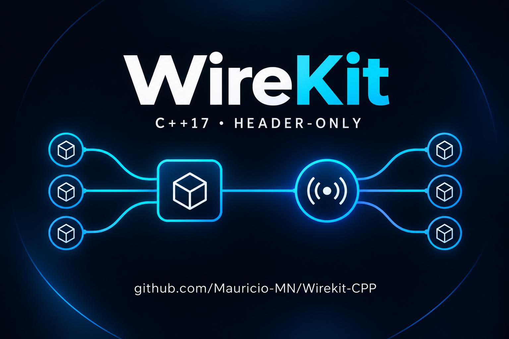

# Wirekit

<p align="center">
  
</p>

Biblioteca C++ header-only (C++17) com duas peças que funcionam juntas ou separadas:

- **`wirekit::Container`**: injeção de dependência. Cada classe declara no construtor o que precisa, e o container monta e entrega. Opcional, ligado por macro.
- **`wirekit::Hub<T>`**: registro de serviços por canal com despacho multicast (uma chamada alcança todas as instâncias de um grupo).

## O que faz

**Injeção de dependência (`Container`).** Você liga cada interface à sua implementação (`bind`) e pede um objeto (`create`). O container lê o construtor, resolve cada parâmetro `std::shared_ptr<T>` e monta a cadeia inteira. Trocar uma implementação, por exemplo o banco real por um fake em teste, é mudar uma linha. Há dois ciclos de vida: `Singleton` (padrão, uma instância por container) e `Transient` (uma nova a cada pedido). Dependência circular lança `std::logic_error`.

**Registro e multicast (`Hub<T>`).** Combina um registro de serviços, uma fábrica selecionada pelo tipo solicitante e despacho multicast. O código cliente depende da interface `T`; uma chamada pode alcançar todas as instâncias daquele canal, em ordem de registro. Canais diferentes mantêm grupos independentes, e `callMethodGet` reúne os resultados de cada instância.

`wirekit::Channel` é um valor que contém apenas o nome do canal. `wirekit::ChannelPtr` é um handle opaco, ligado ao Hub que o criou; handles de outro Hub são rejeitados, e um handle continua inativo após `erase`, mesmo que o nome seja registrado novamente. O hub mantém grupos com serviços até `erase` ou `clear`; descartar o handle não apaga as instâncias.

As duas peças se complementam: um `Hub<T>` pode ser uma dependência do container, como em [`src/examples/container/di_example.cpp`](src/examples/container/di_example.cpp), onde um serviço de pedidos recebe o banco e dispara email e SMS com uma única chamada. O container não substitui o hub: ele entrega **uma** dependência a quem pede, enquanto o hub envia **uma chamada** a todas as instâncias de um grupo.

## Como funciona

**Container.** `bind<I, Impl>()` registra a receita; o objeto só é criado quando alguém o pede e, sendo singleton, fica guardado. `create<T>()` cria um objeto novo, com as dependências injetadas, e não o guarda. A criação de um singleton acontece exatamente uma vez mesmo com várias threads pedindo ao mesmo tempo, e os objetos são destruídos fora dos mutexes. Parâmetros de construtor que não sejam `std::shared_ptr` não são injetados; use `bindFactory` nesses casos.

**Hub.** No modo multithread padrão, mutações do registro são protegidas por mutex e cada despacho captura um snapshot imutável. Despachar por `ChannelPtr` carrega o snapshot atomicamente, sem buscar o nome nem adquirir o mutex do registro; o overload por `Channel&` continua resolvendo por nome. Use `subscribe`/`unsubscribe` para inscrições criadas pela fábrica ou `removeInstance` com o `shared_ptr` registrado. Callbacks executam fora do mutex; remover uma inscrição ou canal não invalida uma chamada já iniciada. Chamadas concorrentes podem executar ao mesmo tempo, mas uma chamada individual percorre suas instâncias sequencialmente.

A sincronização protege o registro, não o estado interno de `T`. Se duas threads chamarem simultaneamente a mesma instância, o próprio serviço precisa ser seguro para isso.

## Como usar

### Injeção de dependência

```cpp
#define WIREKIT_ENABLE_DI
#include <wirekit/wirekit.h>
#include <iostream>
#include <memory>
#include <string>

struct ILogger {
    virtual ~ILogger() = default;
    virtual void log(const std::string& message) const = 0;
};

struct ConsoleLogger final : ILogger {
    void log(const std::string& message) const override { std::cout << message << '\n'; }
};

struct App {
    explicit App(std::shared_ptr<ILogger> logger) : logger(std::move(logger)) {}
    void run() const { logger->log("hello"); }
    std::shared_ptr<ILogger> logger;
};

int main() {
    wirekit::Container container;
    container.bind<ILogger, ConsoleLogger>();  // quem responde por ILogger
    container.create<App>()->run();            // App recebe o logger pronto
}
```

O [`src/examples/container/di_example.cpp`](src/examples/container/di_example.cpp) mostra um caso completo: grafo de dependências, banco compartilhado, `bindFactory` e a troca por um banco fake.

### Hub

Registre as instâncias no canal desejado e chame o método pela interface. Cada chamada abaixo executa `update` nas duas instâncias, em ordem de registro:

```cpp
#include <wirekit/wirekit.h>
#include <memory>

struct RenderStage {
	void update(float) {}
};

int main() {
	wirekit::Hub<RenderStage> stages;
	auto frame = stages.registerChannel("frame");
	stages.addInstance(frame, std::make_shared<RenderStage>());
	stages.addInstance(frame, std::make_shared<RenderStage>());
	constexpr float deltaSeconds = 1.0f / 60.0f;
	stages.callMethod(frame, &RenderStage::update, deltaSeconds);
}
```

## Início rápido

Inclua `wirekit/wirekit.h` no projeto e adicione `src/include` ao include path (`-Isrc/include`). O requisito mínimo é C++17. Para habilitar o container DI, defina `WIREKIT_ENABLE_DI` antes do include (ou inclua `wirekit/container.h` diretamente); sem isso, `wirekit::Container` não existe e `Hub` não muda. O modo padrão é seguro para uso concorrente e protege o registro com mutex. Aplicações estritamente single-thread podem definir `WIREKIT_SINGLE_THREAD` em todas as unidades de tradução para remover os locks; nesse modo, assim como no padrão, chame `collectGarbage()` para remover canais vazios sem handles externos.

A biblioteca não possui dependências externas. O [guia da API](docs/API.md) descreve os canais, as fábricas, o despacho de métodos e a integração. O [`src/examples/hub/hub_example.cpp`](src/examples/hub/hub_example.cpp) é um roteiro comentado para quem está conhecendo o padrão.

O exemplo separa responsabilidades em `src/examples/hub/`: `iuser.h` define o contrato, `user_staff.*` e `user_normal.*` contêm as implementações, e `user_service.*` escolhe qual implementação criar. Assim, o código cliente depende da interface e da fábrica, não dos tipos concretos. A macro `WIREKIT_DECLARE_FACTORY(UserService, IUser)` resume a declaração do hub, mantendo a regra da fábrica em `.cpp`. Alterações apenas nos corpos `.cpp` recompilam somente a unidade alterada; mudanças em headers compartilhados recompilam seus dependentes, como é normal em C++.

Para compilá-lo com GCC:

```sh
g++ -std=c++17 -pthread -Isrc/include \
	src/examples/hub/hub_example.cpp \
	src/examples/hub/user_service.cpp \
	src/examples/hub/user_staff.cpp \
	src/examples/hub/user_normal.cpp \
	-o /tmp/wirekit_example
/tmp/wirekit_example
```

Os testes ficam em [`src/tests/hub_test.cpp`](src/tests/hub_test.cpp). Os benchmarks de despacho e contenção ficam em [`src/benchmarks/dispatch_benchmark.cpp`](src/benchmarks/dispatch_benchmark.cpp) e [`src/benchmarks/collector_benchmark.cpp`](src/benchmarks/collector_benchmark.cpp); os comandos estão no [guia](docs/API.md).

Com CMake (compila e roda testes e exemplos; os benchmarks ficam em um alvo à parte):

```sh
cmake -S . -B build
cmake --build build
ctest --test-dir build --output-on-failure
cmake --build build --target run_benchmarks
cmake --install build --prefix /tmp/wirekit-install

# ASan + UBSan
cmake -S . -B build-san -DWIREKIT_SANITIZE=ON -DCMAKE_BUILD_TYPE=Debug
cmake --build build-san && ctest --test-dir build-san --output-on-failure

# TSan (use a separate build directory)
cmake -S . -B build-tsan -DWIREKIT_THREAD_SANITIZE=ON -DCMAKE_BUILD_TYPE=Debug
cmake --build build-tsan && ctest --test-dir build-tsan --output-on-failure
```

Opções: `WIREKIT_BUILD_TESTS`, `WIREKIT_BUILD_EXAMPLES` e `WIREKIT_BUILD_BENCHMARKS` (`ON` quando o Wirekit é o projeto principal, `OFF` como subprojeto), além de `WIREKIT_SANITIZE` (ASan+UBSan) e `WIREKIT_THREAD_SANITIZE` (TSan), que não podem ser habilitadas juntas. Os testes mantêm os `assert` ativos mesmo em `Release`. Para consumir via CMake, use `add_subdirectory(wirekit)` ou instale e chame `find_package(wirekit CONFIG REQUIRED)`; os alvos exportados são `wirekit::wirekit` (multithread, liga as threads) e `wirekit::single_thread` (define `WIREKIT_SINGLE_THREAD`).

Ou, sem CMake, direto com o compilador:

```sh
g++ -std=c++17 -pthread -Wall -Wextra -Wpedantic -Isrc/include src/tests/hub_test.cpp -o /tmp/hub_test
/tmp/hub_test
g++ -std=c++17 -Wall -Wextra -Wpedantic -Isrc/include src/tests/hub_test_st.cpp -o /tmp/hub_test_st
/tmp/hub_test_st
g++ -std=c++17 -pthread -Wall -Wextra -Wpedantic -Isrc/include src/tests/container_test.cpp -o /tmp/container_test
/tmp/container_test
g++ -std=c++17 -Wall -Wextra -Wpedantic -Isrc/include src/tests/container_test_st.cpp -o /tmp/container_test_st
/tmp/container_test_st
```

O segundo teste usa `WIREKIT_SINGLE_THREAD` e compila sem `-pthread`. Essa macro precisa ser definida igualmente em todas as unidades de tradução; não use esse modo se o hub puder ser acessado concorrentemente.

## Como modificar

O caller passado a `addInstance(channel, caller)` não é retido; [`registration_modes.cpp`](src/examples/hub/registration_modes.cpp) demonstra registro por cópia e por `shared_ptr`. Alterações nos corpos `.cpp` exigem recompilar essa unidade e relinkar a aplicação. Alterações em headers compartilhados exigem recompilar as unidades que os incluem.

## Estado da implementação

O container DI é experimental: a API pode mudar. Ainda não há ciclo de vida por escopo (por requisição) nem containers filhos. Consulte o [roadmap](ROADMAP.md) para itens planejados e o [changelog](CHANGELOG.md) para alterações realizadas.

## Estrutura do projeto

```text
src/include/       headers da biblioteca (wirekit.h e wirekit/{detail,hub,container}.h)
src/tests/         testes
src/benchmarks/    benchmarks
src/examples/hub/        exemplo do Hub
src/examples/container/  exemplo do Container (DI)
docs/              guia da API
```

## Licença

Consulte [`LICENSE`](LICENSE).
